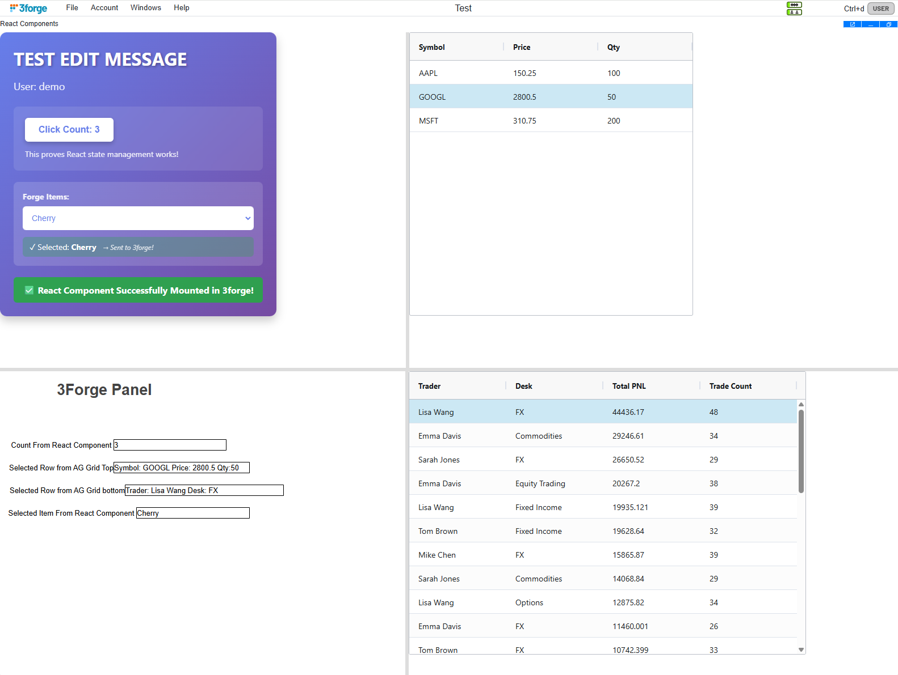

# 3forge Trading Dashboard Project

## 🎯 **Project Overview**
Professional trading dashboard built with 3forge AMI, featuring **complete 4-panel inter-widget communication**, custom Java classes, automated build system, and enterprise-grade development workflow.

## 🚀 **Current Status**

### ✅ **Major Achievements:**
- **🎉 COMPLETE 4-PANEL DASHBOARD**: Table clicking updates all panels simultaneously
- **⚛️ CUSTOM REACT INTEGRATION**:  Components with bidirectional communication
- **📊 Dynamic HTML Panel**: Real-time trader performance cards with custom CSS styling
- **🔥 Smart Heatmap Filtering**: Shows only symbols the selected trader has traded
- **📈 Chart Integration**: P&L charts filter by trader selection
- **🔄 Inter-Widget Communication**: Seamless data flow between all dashboard components
- **🎯 Realistic Data Separation**: Each trader trades only their preferred symbols

### ✅ **What's Working:**
- **Trading Dashboard**: Complete 4-panel inter-widget communication system
- **React Components**: HelloWorld (demo) + AG-Grid (data grid) + StockChart (Highstock) + TraderDetailsCard with Shadow DOM
- **Custom Java Classes**: `TradingDashboardManager` (HTML generation) + `PanelManager` (panel utilities)
- **React Plugin System**: `ReactGuiPlugin` + `ReactGuiAdapter` for seamless 3forge integration
- **Data Sources**: SQLite database with trader-specific symbol preferences
- **Build System**: Dual dev/prod deployment pipeline + React/Vite build
- **Backup System**: Master backup with nuclear recovery option
- **Reset Functionality**: Click any non-trader column to clear filters

### 🛠️ **Development Setup:**
- **Build for Deployment**: `gradle buildProd` + `.\scripts\rebuild-prod.ps1`
- **Development Mode**: `gradle buildDev` + `.\scripts\rebuild-dev.ps1` 
- **Recovery**: `gradle restoreWorkingState` (bulletproof backup restore)

## 🏆 **BREAKTHROUGH FEATURES**

### 🎯 **4-Panel Inter-Widget Communication**
**Implementation**: Click any trader name to see:
1. **HTML Panel**: Dynamic trader performance metrics with custom styling
2. **Heatmap**: Filtered to show only symbols that trader has traded
3. **P&L Chart**: Filtered to show only that trader's performance
4. **All Panels Reset**: Click any non-trader column to return to full view

### 🎨 **Dynamic HTML Panel Generation**
- **Real-time metrics**: P&L, trade count, win rate, top symbol
- **Professional styling**: CSS-based performance cards
- **Color-coded indicators**: Green/red P&L, responsive design
- **Trader-specific data**: Calculated from actual trading activity

### 🔥 **Smart Data Filtering**
- **Trader-Symbol Mapping**: Each trader only trades their preferred symbols
- **Tom Brown**: AMZN, ORCL, INTC
- **Mike Chen**: GOOGL, NVDA, AMD  
- **Sarah Jones**: AAPL, TSLA, META
- **Lisa Wang**: TSLA, META, NVDA
- **John Smith**: AAPL, MSFT, GOOGL
- **Emma Davis**: AAPL, AMZN, MSFT

## ⚛️ **REACT COMPONENT INTEGRATION**

### 🎯 **Custom React Components in 3forge**
**Implementation**: Clean, simple architecture for embedding React components with bidirectional communication.



### **Components Available:**
1. **HelloWorld**: Demo component showing prop passing, state management, and event callbacks
2. **AgGrid**: Advanced data grid with sorting, filtering, row selection, and event handling
3. **StockChart**: Financial chart using Highstock with range selector, navigator, and zoom controls
4. **TraderDetailsCard**: Dynamic trader metrics card that updates on grid row selection

### **Architecture:**
- **Java Plugin**: `ReactGuiPlugin` + `ReactGuiAdapter` (AmiScript API)
- **JavaScript Bridge**: `ReactGuiService.js` (connects Java to React)
- **React Bundle**: `forge-react.js` (single-file deployment with Shadow DOM)
- **Build System**: Vite + TypeScript for fast development

### **How to Use (3forge Developer):**

#### **Mount HelloWorld Component:**
```javascript
// In Div component AmiScript
reactGui = __ReactGui;

reactGui.mountComponent("myDiv", "HelloWorld", {
    message: "Welcome!",
    userName: session.username,
    forgeItems: ["Trade", "Quote", "Order"]
});

// Handle events from React
onAmiJsCallback(action, param) {
    if (action == "buttonClicked") {
        session.alert("Count: " + param[0]);
    } else if (action == "itemSelected") {
        session.alert("Selected: " + param[0]);
    }
}
```

#### **Mount AG-Grid Component:**
```javascript
// In Div component AmiScript
reactGui = __ReactGui;

// Define columns
columns = new List();
columns.add({field: "symbol", headerName: "Symbol", width: 150});
columns.add({field: "price", headerName: "Price", width: 120});

// Define data
rows = new List();
rows.add({symbol: "AAPL", price: 150.25, quantity: 100});
rows.add({symbol: "GOOGL", price: 2800.50, quantity: 50});

// Mount grid
reactGui.mountComponent("myDiv", "AgGrid", {
    columns: columns,
    rows: rows
});

// Handle grid events
onAmiJsCallback(action, param) {
    if (action == "rowClicked") {
        session.alert("Clicked: " + param[0].symbol);
    }
}
```

### **🔧 Critical Setup: Panel Visibility on Startup**

**IMPORTANT**: To ensure React panels display correctly when the dashboard loads, you **must** call the panel's `onVisible` method in the dashboard's `onUserPrefsLoaded()` callback. if you are populating the ag-grid with data from a datamodel, you should put it in the datamodels onComplete method instead.  

**How to configure:**
1. Go to **Dashboard → Custom Callbacks**
2. Find or create the **`onUserPrefsLoaded()`** callback
3. Add `invokeCallback("onVisible", true)` for each React panel

**Example:**
```javascript
onUserPrefsLoaded() {
    // Ensure React panels are visible on dashboard load
    agGrid.invokeCallback("onVisible", true);
    reactPanel.invokeCallback("onVisible", true);
    
}
    // Your other initialization logic should go in the html panels amiscript section
    // specifically the onVisible callBack.
    __ReactGui.mountComponent("agGrid", "AgGrid", {...});
    __ReactGui.mountComponent("reactPanel", "HelloWorld", {...});
```

**Why this is needed:** to ensure your React components mount correctly on page load.

### **⚠️ Container Requirements:**
**CRITICAL**: The Div container **must have explicit width and height** set:
```
width: 800px; height: 600px;
```
Without explicit dimensions, AG-Grid (and complex components) cannot render properly.

### **Bidirectional Communication:**
- **3forge → React**: Pass props via `mountComponent(elementId, componentName, props)`
  - Java `List` → JavaScript `Array`
  - Java `Map` → JavaScript `Object`
  - Primitives auto-convert
- **React → 3forge**: Send events via `window.amiJsCallback(element, action, ...params)`
  - Captured in Div's `onAmiJsCallback` section

### **Development Workflow:**

#### **Build React Components:**
```bash
cd react-components
npm install
npm run build  # Output: resources/forge-react.js
```

#### **Deploy to 3forge:**
```bash
Copy-Item "resources\forge-react.js" -Destination "C:\Program Files\ami\amione\resources\forge-react.js" -Force
```

#### **Add New Component:**
1. Create `react-components/src/MyComponent.tsx`
2. Register in `react-components/src/main.tsx` COMPONENTS registry
3. Build and deploy: `npm run build`
4. Use in 3forge: `reactGui.mountComponent("myDiv", "MyComponent", {...})`

### **Key Features:**
- ✅ **Shadow DOM**: Complete style isolation (React CSS won't affect 3forge UI)
- ✅ **Single Bundle**: One `forge-react.js` file contains all components
- ✅ **TypeScript**: Type-safe component development
- ✅ **Fast Builds**: Vite for sub-second rebuilds
- ✅ **No Over-Engineering**: Simple, explicit API

## 🚨 **CRITICAL LESSONS LEARNED**

### 🎯 **Key Discovery: 3forge IDE Autocomplete**
**Critical Insight**: Use **Ctrl+Space** in AMI script editor for complete API discovery. Complex object passing works perfectly with correct syntax from IDE autocomplete.

### 🔍 **AMI Script Debugging Mastery**
**KEY INSIGHTS:**
- **Comprehensive logging**: Every filter operation tracked
- **WHERE clause debugging**: Real-time query construction visibility  
- **Datamodel syntax**: `Datamodel dm = layout.getDatamodel("name"); dm.process(params);`
- **No try-catch blocks**: AMI script doesn't support exception handling
- **Variable interpolation**: Use `${WHERE}` for parameter passing

### ⚠️ **VM Options: The Nuclear Landmine**

**NEVER manually edit `C:\Program Files\ami\amione\AMI_One.vmoptions`**

**What we learned the hard way:**
- ❌ Custom VM options (memory settings, debug flags) **CRASH 3forge**
- ❌ Once corrupted, the issue **PERSISTS across restarts**
- ❌ Standard backup/restore **DOESN'T FIX IT** (restores corrupt options)
- ❌ Only solution: **COMPLETE NUCLEAR REINSTALL**

**Nuclear Recovery Process (Last Resort):**
```bash
# 1. Complete AMI removal
Remove-Item -Path "C:\Program Files\ami" -Recurse -Force

# 2. Fresh 3forge installation from installer
# 3. ⚠️  IMPORTANT: Generate new license (old license removed with AMI)
# 4. Follow docs/DATA_SOURCE_SETUP.md for data sources
# 5. Deploy custom classes: gradle buildProd
# 6. Create new clean backup: gradle backupWorkingState
```

### 🛡️ **Current Safe Build System**

**We REMOVED VM options deployment from all build tasks:**
- ✅ `gradle buildProd` - NO VM options (uses 3forge defaults)
- ✅ `gradle buildDev` - NO VM options (safe for all environments)
- ✅ Custom classes + configuration ONLY

**This prevents the nightmare cycle permanently.**

## 📁 **Project Structure**

```
3forge/
├── src/                     # Java source code
│   └── main/java/com/forge/trading/
│       ├── TradingDashboardManager.java  # HTML generation & trader metrics
│       ├── PanelManager.java            # Panel manipulation utilities (legacy)
│       ├── ReactGuiPlugin.java          # React plugin entry point
│       └── ReactGuiAdapter.java         # React AmiScript API
├── react-components/        # React project (Vite + TypeScript)
│   ├── src/
│   │   ├── main.tsx        # Component registry & mount logic
│   │   ├── HelloWorld.tsx  # Demo component
│   │   ├── AgGridComponent.tsx  # AG-Grid wrapper
│   │   └── ag-grid-styles.ts    # Custom AG-Grid overrides
│   ├── package.json
│   ├── vite.config.ts
│   └── tsconfig.json
├── resources/               # Deployed resources
│   ├── ReactGuiService.js  # JavaScript bridge
│   └── forge-react.js      # Bundled React components
├── dashboards/              # 3forge JSON files
│   └── 3forge.json         # Complete 4-panel dashboard configuration
├── config/                  # Configuration management
│   ├── CONFIG_GUIDE.md     # Complete development guide
│   ├── ami-custom.local.properties # Custom class + plugin registrations
│   └── working-state-backup/ # Master backup directory
├── scripts/                 # PowerShell automation
│   ├── rebuild-dev.ps1     # Development rebuild + restart
│   └── rebuild-prod.ps1    # Build + restart
├── docs/                    # Documentation
│   ├── TECHNICAL_GUIDE_COMPLETE.md # Technical implementation details
│   ├── DATA_SOURCE_SETUP.md # Database setup guide
│   └── README_SETUP.md     # Installation instructions
├── data/                    # Database and mock data
│   └── py/ami.py           # Realistic trader-symbol data generation
├── build.gradle            # Gradle build configuration
├── trading_data.db         # SQLite database (project root)
└── README.md               # This file
```

## 🔄 **Development Workflow**

### **Daily Development:**
```bash
# For Java changes (requires rebuild)
gradle buildProd
.\scripts\rebuild-prod.ps1

# For React component changes
cd react-components
npm run build
Copy-Item "..\resources\forge-react.js" -Destination "C:\Program Files\ami\amione\resources\forge-react.js" -Force
# Hard refresh browser (Ctrl+Shift+R)

# For JSON/AMI Script changes (fast restart)
# Just restart 3forge manually (~5 seconds)

# For data changes (regenerate database)
python data/py/ami.py
```

### **Nuclear Recovery (When Things Break):**
```bash
# Option 1: Master backup restore (90% of cases)
gradle restoreWorkingState

# Option 2: Complete nuclear reinstall (VM options corruption)
# See nuclear recovery process above
```

## 📊 **Data Sources & Demo Data**

**SQLite Database**: `trading_data.db`
- **Tables**: trades, positions, marketdata, riskmetrics, orders
- **Setup**: Follow `docs/DATA_SOURCE_SETUP.md` after fresh installs
- **Preserved**: In master backups (data sources automatically restored)

**Demo Data Features:**
- **Trader-Symbol Separation**: Each trader only trades 3 specific symbols
- **Realistic Volumes**: 1000 trades with trader-specific patterns
- **Market Data**: Complete pricing data for all symbols
- **Performance Metrics**: Calculated P&L, win rates, trade counts

## 🎮 **Using the Dashboard**

### **Interactive Demo:**
1. **Click any trader name** → See their specific data across all 4 panels
2. **Watch the HTML panel** → Real-time trader performance metrics
3. **Check the heatmap** → Shows only symbols that trader trades
4. **View the P&L chart** → Filtered to show only that trader's performance
5. **Reset the view** → Click any non-trader column (Price, Volume, etc.)

### **Trader Profiles:**
- **Tom Brown**: Conservative, trades AMZN/ORCL/INTC
- **Lisa Wang**: Tech focus, trades TSLA/META/NVDA  
- **Mike Chen**: Aggressive, trades GOOGL/NVDA/AMD
- **Sarah Jones**: Balanced, trades AAPL/TSLA/META

## 🎯 **Key Success Factors**

### **What Made This Work:**
1. **Complete inter-widget communication** - All panels update simultaneously
2. **Realistic data separation** - Each trader has distinct trading patterns
3. **Professional HTML generation** - Custom CSS styling for performance cards
4. **Comprehensive logging** - Every filter operation tracked for debugging
5. **Master backup strategy** - Single source of truth for recovery
6. **NO VM options** - Eliminated nuclear failure mode

### **Custom Java Architecture:**
- **TradingDashboardManager**: Main class for HTML generation and trader metrics calculation
  - `generateTraderHtml()`: Creates dynamic performance cards with CSS styling
  - `calculateTraderMetrics()`: Computes P&L, trade counts, win rates
  - **Status**: Actively used in 4-panel dashboard
- **PanelManager**: Legacy utility class for panel manipulation via reflection
  - `updateHtmlPanel()`: Reflection-based panel content updates
  - `getPanelInfo()`: Debug utilities for panel introspection
  - **Status**: Legacy - superseded by direct AMI script panel access

### **Critical Dependencies:**
- ✅ 3forge AMI installation
- ✅ Java 8+ runtime
- ✅ Gradle build tool
- ✅ SQLite database
- ✅ PowerShell execution policy

## 📚 **Documentation Index**

- **`config/CONFIG_GUIDE.md`** - Complete build/deployment guide
- **`docs/DATA_SOURCE_SETUP.md`** - Post-install data source setup
- **`docs/README_SETUP.md`** - Original setup documentation  
- **This README** - Project overview and achievements

## 🚀 **Quick Start (After Fresh Install)**

1. **Deploy custom classes**: `gradle buildProd`
2. **Setup data sources**: Follow `docs/DATA_SOURCE_SETUP.md`
3. **Generate demo data**: `python data/py/ami.py`
4. **Test functionality**: Click trader names, verify 4-panel updates
5. **Create backup**: `gradle backupWorkingState`

---

**🎉 Current State: Complete Dashboard**
- 4-panel inter-widget communication: ✅ 
- React component integration (HelloWorld + AgGrid + StockChart + TraderDetailsCard): ✅
- Dynamic HTML panel generation: ✅
- Smart heatmap filtering: ✅
- Chart integration: ✅
- Reset functionality: ✅
- Realistic demo data: ✅
- Comprehensive logging: ✅
- Build system: ✅
- Recovery system: ✅

**Last Major Update**: React component integration with Shadow DOM & bidirectional communication
**Master Backup**: Clean state ready for deployment
**Demo Status**: Ready for professional presentation 🚀